<p align="center">
  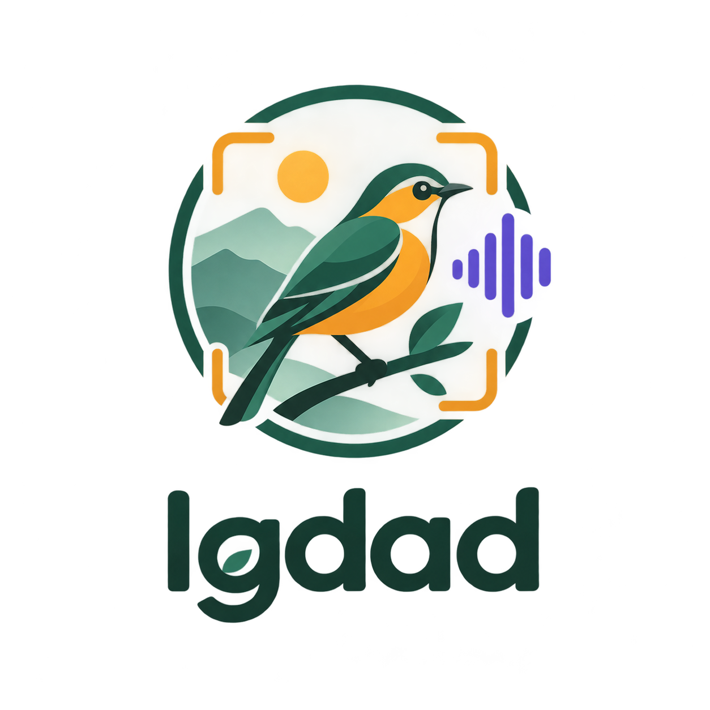
</p>

<h1 align="center">Igdad</h1>

<p align="center">
  Reconnaître les oiseaux du Maroc par leur chant et par la photo.<br>
  83 espèces · data lake bronze/silver/gold sur MinIO + PySpark · EfficientNet-B0 (audio) · YOLO11s (image) · application iPhone
</p>

---

Igdad (« les oiseaux » en amazigh) est un projet de fin d'études d'ingénieur à l'EMSI. Il couvre toute la chaîne : collecte des enregistrements Xeno-canto et des photos iNaturalist, data lake **TAGHRID** (« le chant des oiseaux » en arabe), entraînement de deux modèles et application mobile qui identifie l'oiseau en direct, au micro ou à la caméra.

## Captures d'écran

| Accueil | Chant en temps réel | Photo en direct | Les 83 oiseaux |
|:---:|:---:|:---:|:---:|
| 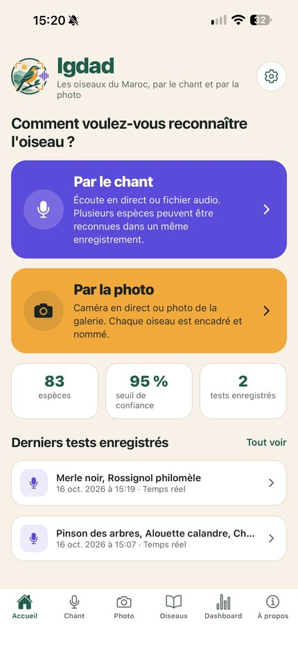 | 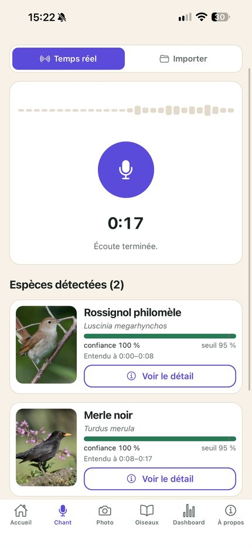 | 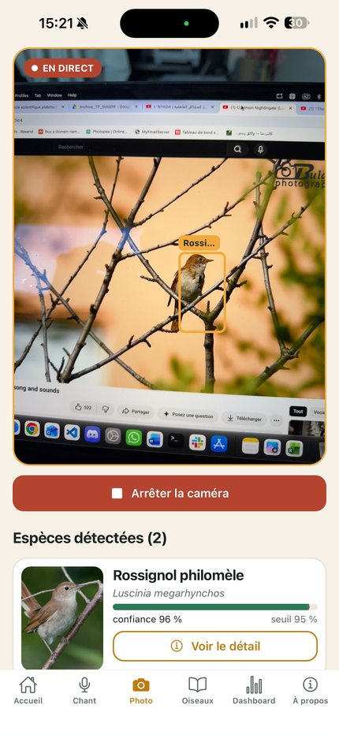 | 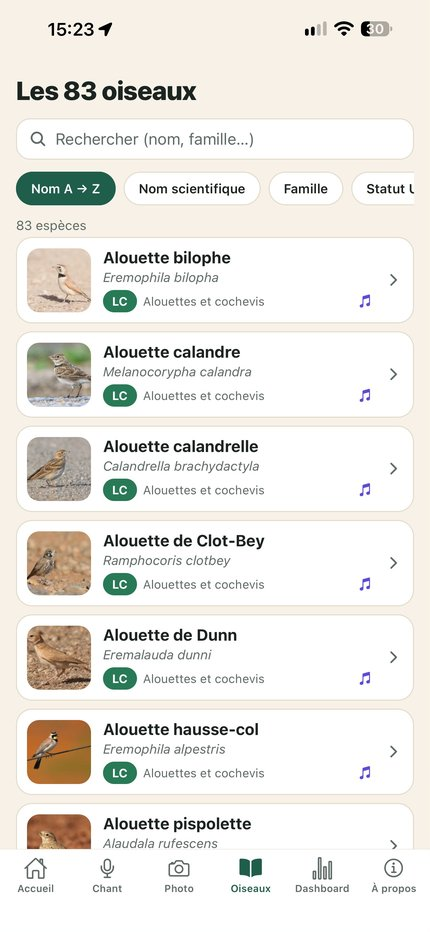 |

| Fiche espèce | Présence au Maroc | Zone d'observation | Réglages |
|:---:|:---:|:---:|:---:|
| 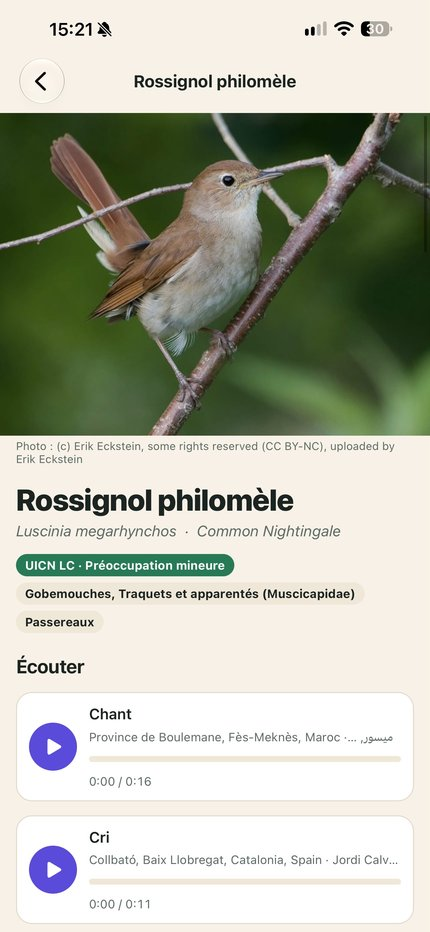 | 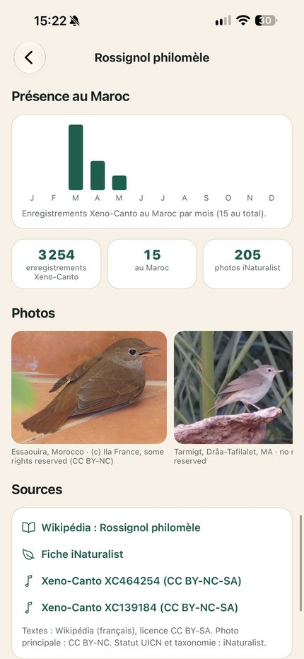 | 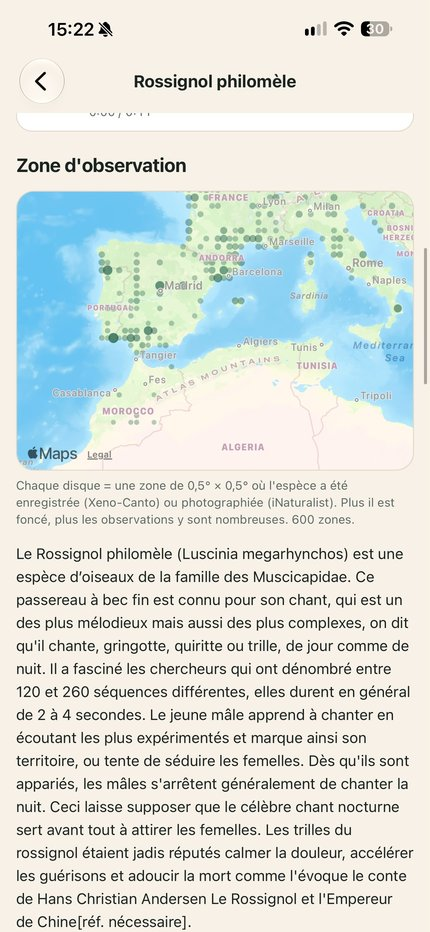 | 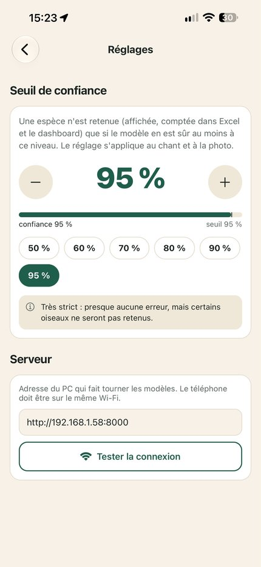 |

| Tableau de bord | Espèces et carte | Activité et familles |
|:---:|:---:|:---:|
| 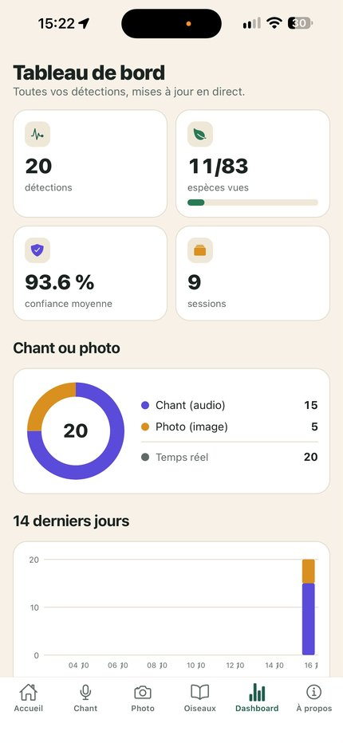 | 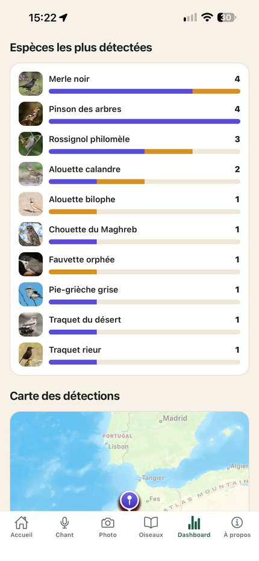 | 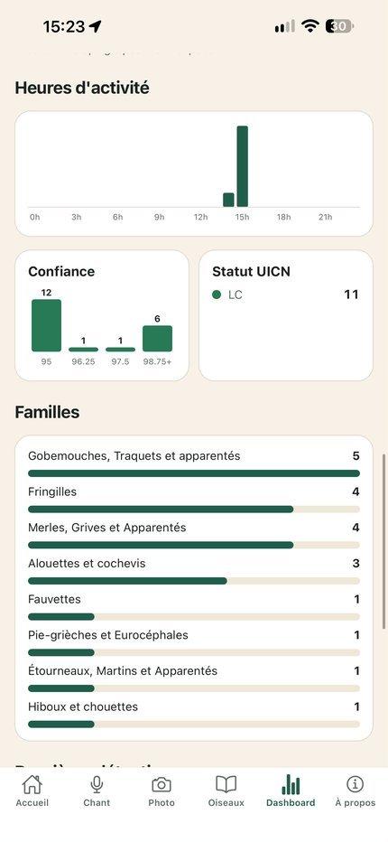 |

## Fonctionnalités

- **Par le chant, en temps réel** : le téléphone envoie le son du micro (32 kHz) toutes les 1,2 s ; le serveur analyse les 5 dernières secondes. Trois garde-fous limitent les fausses détections : pas de prédiction avant 3 s d'écoute, pas de prédiction si le son est trop faible, et une espèce n'est retenue qu'après 2 prédictions concordantes.
- **Par le chant, import d'un fichier** (m4a, mp3, wav) : découpage en fenêtres de 5 s et frise chronologique des espèces entendues.
- **Par la photo** : caméra en direct ou photo de la galerie ; chaque oiseau est encadré et nommé.
- **Fiches des 83 espèces** : noms français et scientifique, statut UICN, texte Wikipédia, photos, chants et cris, mois de présence au Maroc, carte des observations.
- **Tableau de bord** : détections par espèce, par famille, par heure, carte des détections.
- **Seuil de confiance réglable** (50 à 99 %) ; chaque détection est enregistrée avec sa position GPS dans un fichier CSV et Excel.

## Architecture

```
Xeno-canto API ─┐                    MinIO (API S3)
iNaturalist API ─┼─▶  BRONZE  ──Spark──▶  SILVER  ──Spark──▶  GOLD  ──▶  entraînement
Wikipédia ───────┘   audio, photos,       catalogues Parquet,    spectrogrammes,     EfficientNet-B0
                     JSON bruts           contrôle qualité,      dataset YOLO,       YOLO11s
                                          boîtes pré-annotées    analyses, fiches        │
                                                                                         ▼
                              iPhone (Expo / React Native)  ◀── Wi-Fi ──▶  API d'inférence (port 8000)
```

| Couche | Taille | Contenu |
|---|---|---|
| Bronze | 40 Gio | 15 389 fichiers audio (153 h), 15 853 photos, réponses brutes des API |
| Silver | 31 Mio | catalogues typés et validés (Parquet), pré-annotation des photos |
| Gold | 3,9 Gio | 39 706 mel-spectrogrammes, dataset YOLO de 14 765 images, 12 tables d'analyse |

## Résultats

**Audio** (EfficientNet-B0, 83 espèces, 881 enregistrements de test)

| Mesure | Score |
|---|---|
| Précision par enregistrement | 88,6 % |
| F1 macro par enregistrement | 0,815 |
| Précision par segment de 5 s | 80,7 % |

Par pays : Portugal 93,2 %, Espagne 90,6 %, Maroc 82,2 %. Les espèces sahariennes, qui ont peu d'enregistrements publics, restent les plus difficiles.

**Image** (YOLO11s, 1 514 images de test) : mAP@0.5 = 0,794, mAP@0.5:0.95 = 0,706. Les boîtes d'entraînement ont été générées automatiquement par un YOLO pré-entraîné sur COCO, puis étiquetées avec l'espèce de l'observation iNaturalist.

## Structure du dépôt

```
app/          serveur d'inférence (mobile_api.py) et interface web de démonstration (server.py)
scripts/      ingestion, jobs PySpark bronze → silver → gold, entraînement des modèles
mobile/       application Expo / React Native (src/app : écrans, src/lib : client API)
runs/         modèles finaux et métriques (audio : best.pt, test_report.txt ; image : weights/best.pt)
docs/         captures d'écran
logo/         logo de l'application
```

## Installation

Prérequis : macOS ou Linux, Python 3.13, Java 17 (pour Spark), [MinIO](https://min.io) et son client `mc`, Node.js, Xcode pour l'iPhone.

```bash
git clone https://github.com/AlaeLahbichi/Igdad_Mobile_App.git
cd Igdad_Mobile_App
python3 -m venv .venv && .venv/bin/pip install -r requirements.txt
cp .env.example .env        # identifiants MinIO à choisir
```

### Reconstruire le data lake

```bash
bash scripts/lake_start.sh                    # MinIO : API :9000, console :9001
bash scripts/lake_init.sh                     # buckets taghrid-bronze / -silver / -gold
XC_API_KEY=<clé> .venv/bin/python scripts/ingest_xc_metadata.py
bash scripts/lake_build.sh                    # audio : bronze → silver → gold
.venv/bin/python scripts/ingest_inat_images.py
bash scripts/lake_build_images.sh             # photos : bronze → silver → gold
.venv/bin/python scripts/ingest_species_info.py && .venv/bin/python scripts/lake_gold_species.py
```

Une clé d'API Xeno-canto s'obtient gratuitement avec un compte sur [xeno-canto.org](https://xeno-canto.org).

### Entraîner les modèles

```bash
.venv/bin/python scripts/train_audio_classifier.py      # → runs/audio/<date>/
.venv/bin/python scripts/train_yolo_detector.py         # → runs/detect/<date>/
```

### Lancer l'application

```bash
bash scripts/igdad_start.sh          # MinIO + API d'inférence sur le port 8000
bash scripts/igdad_start.sh stop     # tout arrêter
```

Puis, pour l'application mobile :

```bash
cd mobile
npm install
npx expo run:ios --device           # compile et installe sur l'iPhone branché
```

Dans l'application, **Réglages › Serveur** : indiquer l'adresse du Mac (par exemple `http://192.168.1.58:8000`). Le téléphone et le Mac doivent être sur le même Wi-Fi.

## Données et licences

- Enregistrements : [Xeno-canto](https://xeno-canto.org), majoritairement sous licences Creative Commons non commerciales (CC BY-NC-SA, CC BY-NC-ND).
- Photos : observations « research grade » d'[iNaturalist](https://www.inaturalist.org), licences Creative Commons indiquées pour chaque photo.
- Textes des fiches : [Wikipédia](https://fr.wikipedia.org) (CC BY-SA).

Les fichiers audio et les photos ne sont pas inclus dans ce dépôt : les scripts d'ingestion les téléchargent depuis les sources, dans le respect de leurs licences. Projet non commercial.

## Auteur

**Alae Lahbichi** — 5ᵉ année du cycle ingénieur, EMSI Agdal 2, Rabat.
